# Class Activity 1 — System Calls in Practice

- **Student Name:** CHHEM SOPHEA
- **Student ID:** e20230596
- **Date:** 20.10.2026

---

## Warm-Up: Hello System Call

Screenshot of running `hello_syscall.c` on Linux:

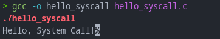

Screenshot of running `hello_winapi.c` on Windows (CMD/PowerShell/VS Code):

Screenshot of running `copyfilesyscall.c` on Linux:

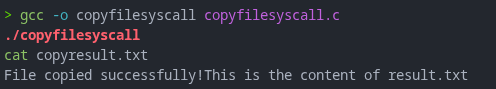

---

## Task 1: File Creator & Reader

### Part A — File Creator

**Describe your implementation:** [What differences did you notice between the library version and the system call version?]

**Version A — Library Functions (`file_creator_lib.c`):**

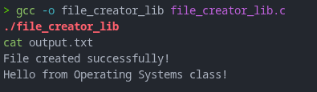

**Version B — POSIX System Calls (`file_creator_sys.c`):**

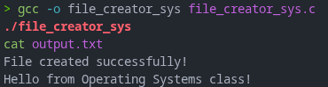

**Questions:**

1. **What flags did you pass to `open()`? What does each flag mean?**

   `O_WRONLY` opens the file for writing, `O_CREAT` creates it if it is
   missing, and `O_TRUNC` clears its old contents.

2. **What is `0644`? What does each digit represent?**

   It is an octal permission mode. The owner can read and write the file.
   The group and other users can read it.

3. **What does `fopen("output.txt", "w")` do internally that you had to do manually?**

   It creates the file if it is missing and clears it if it already exists.
   With `open()`, the flags and permissions have to be set directly.

### Part B — File Reader & Display

**Describe your implementation:** [Your notes]

**Version A — Library Functions (`file_reader_lib.c`):**

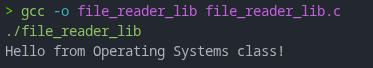

**Version B — POSIX System Calls (`file_reader_sys.c`):**

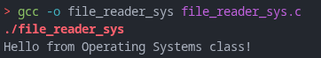

**Questions:**

1. **What does `read()` return? How is this different from `fgets()`?**

   `read()` returns the number of bytes read, `0` at end of file, or `-1` on
   error. `fgets()` reads up to a newline or its buffer limit and adds a null
   character.

2. **Why do you need a loop when using `read()`? When does it stop?**

   A `read()` call may return fewer bytes than requested. The loop stops when
   `read()` returns `0`, which means the file has ended.

---

## Task 2: Directory Listing & File Info

**Describe your implementation:** [Your notes]

### Version A — Library Functions (`dir_list_lib.c`)

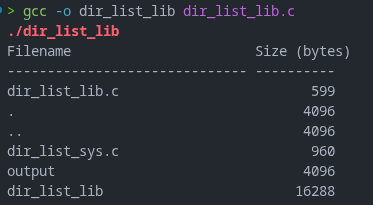

### Version B — System Calls (`dir_list_sys.c`)

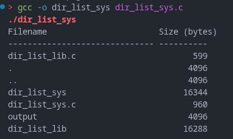

### Questions

1. **What struct does `readdir()` return? What fields does it contain?**

   It returns a pointer to a `struct dirent`, or `NULL` when there are no
   more entries. `d_name` contains the entry name. On Linux, `d_ino` contains
   its inode number.

2. **What information does `stat()` provide beyond file size?**

   It provides the file type, permissions, owner and group IDs, timestamps,
   inode number, and link count.

3. **Why can't you `write()` a number directly — why do you need `snprintf()` first?**

   `write()` writes bytes. `snprintf()` turns the number into printable
   decimal text and formats it with the filename.

---

## Optional Bonus: Windows API (`file_creator_win.c`)

Screenshot of running on Windows:

### Bonus Questions

1. **Why does Windows use `HANDLE` instead of integer file descriptors?**

   > [Your answer]

2. **What is the Windows equivalent of POSIX `fork()`? Why is it different?**

   > [Your answer]

3. **Can you use POSIX calls on Windows?**

   > [Your answer]

---

## Task 3: strace Analysis

**Describe what you observed:** [What surprised you about the strace output? How many more system calls did the library version make?]

### strace Output — Library Version (File Creator)

### strace Output — System Call Version (File Creator)

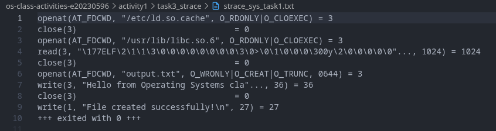

### strace Output — Library Version (File Reader or Dir Listing)

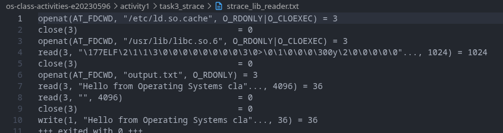

### strace Output — System Call Version (File Reader or Dir Listing)

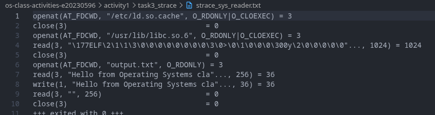

### strace -c Summary Comparison

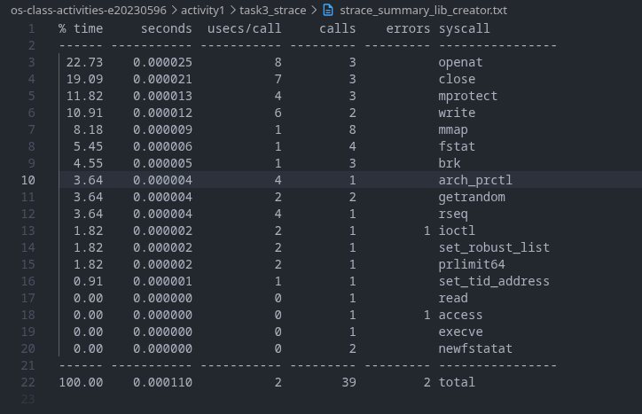
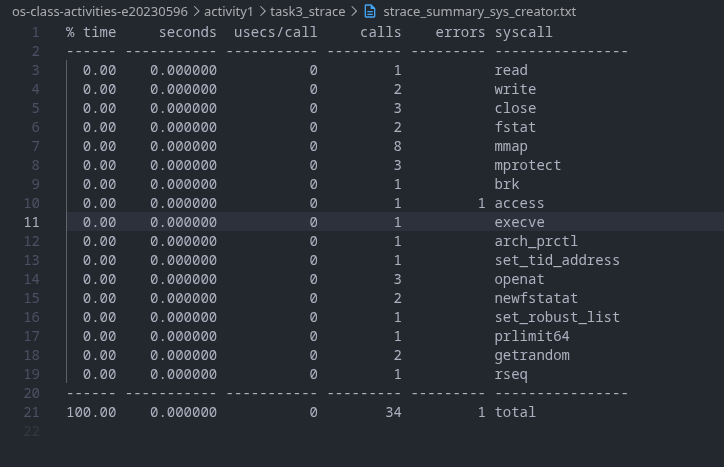

### Questions

1. **How many system calls does the library version make compared to the system call version?**

   The creator made 39 calls with the library version and 34 with the system
   call version. The reader made 40 and 35. These totals include startup
   calls.

2. **What extra system calls appear in the library version? What do they do?**

   In both Task 1 programs, the library version made two more `fstat()` calls
   and two more `brk()` calls. `fstat()` gets information about an open file.
   `brk()` changes the program's heap. The creator also had one failed
   `ioctl()` call. Both versions made the same number of `mmap()` and
   `access()` calls.

3. **How many `write()` calls does `fprintf()` actually produce?**

   There is one `write()` for the text from `fprintf()` and one for the
   confirmation from `printf()`. The file text is buffered and written when
   the file is closed.

4. **In your own words, what is the real difference between a library function and a system call?**

   A library function runs in the program and may do extra work before
   requesting a service from the kernel. A system call is the request to the
   kernel itself. For example, `fopen()` uses file system calls underneath,
   while `open()` requests the file operation directly.

---

## Task 4: Exploring OS Structure

### System Information

Screenshot of `uname -a`, `/proc/cpuinfo`, `/proc/meminfo`, `/proc/version`, and `/proc/uptime`:

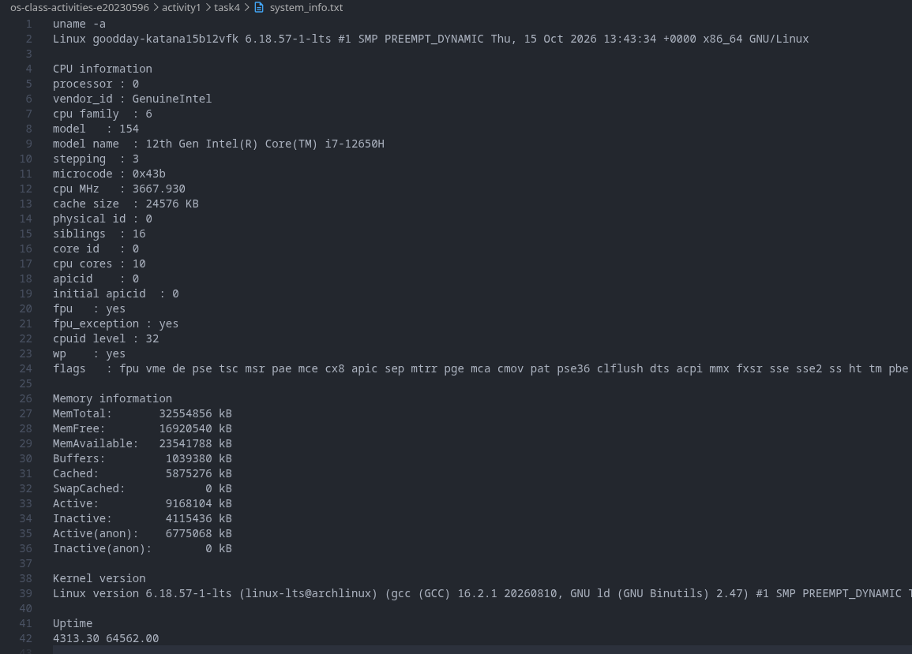

### Process Information

Screenshot of `/proc/self/status`, `/proc/self/maps`, and `ps aux`:

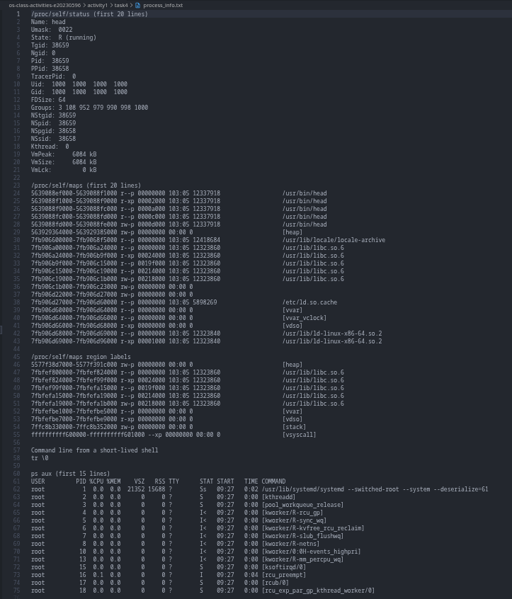

### Kernel Modules

Screenshot of `lsmod` and `modinfo`:

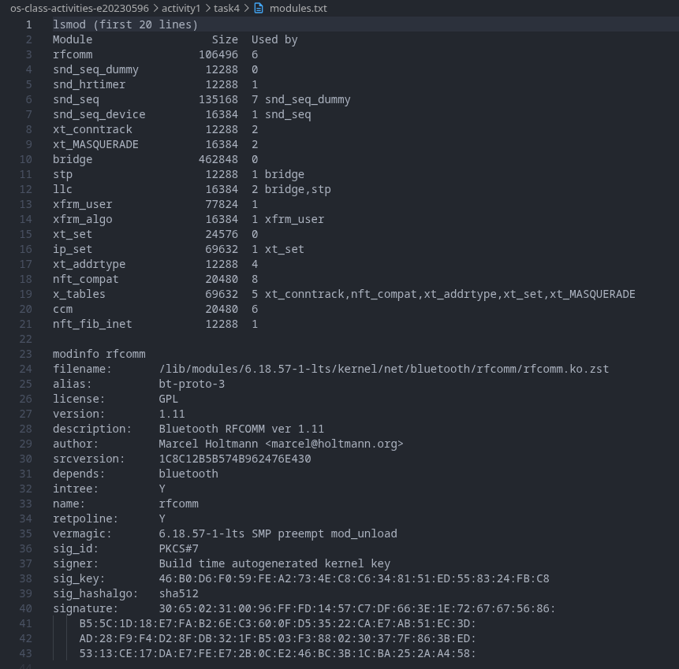

### OS Layers Diagram

Screenshot of your diagram of the OS layers, labeled with real data from your system:

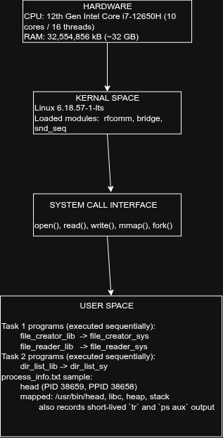

### Questions

1. **What is `/proc`? Is it a real filesystem on disk?**

   `/proc` is a virtual filesystem, not stored on disk. The kernel supplies
   its contents when they are read.

2. **Monolithic kernel vs. microkernel — which type does Linux use?**

   A monolithic kernel runs most operating system services in kernel space. A
   microkernel keeps fewer services in kernel space and runs more in user
   space. Linux is monolithic, though it also supports loadable modules.

3. **What memory regions do you see in `/proc/self/maps`?**

   The maps show the program, heap, stack, shared libraries such as `libc`,
   and kernel-provided regions such as `[vdso]` and `[vvar]`.

4. **Break down the kernel version string from `uname -a`.**

   `Linux` is the kernel name, followed by the hostname. `6.18.57-1-lts` is
   the kernel release. `#1` is the build number, and `SMP PREEMPT_DYNAMIC`
   describes the build. The next part is the build date. `x86_64` is the
   machine architecture, and `GNU/Linux` is the operating system.

5. **How does `/proc` show that the OS is an intermediary between programs and hardware?**

   Programs get system and hardware information through files provided by the
   kernel in `/proc`, rather than reading hardware directly.

---

## Reflection

What did you learn from this activity? What was the most surprising difference between library functions and system calls?

> [Write your reflection here]
