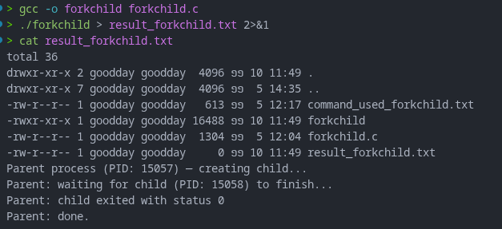
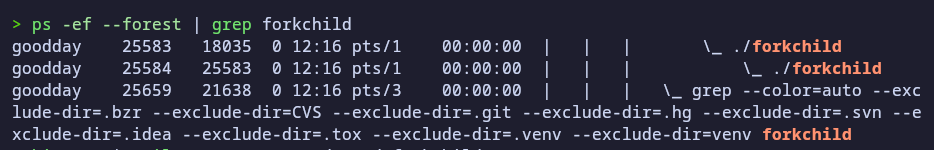
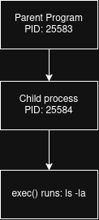
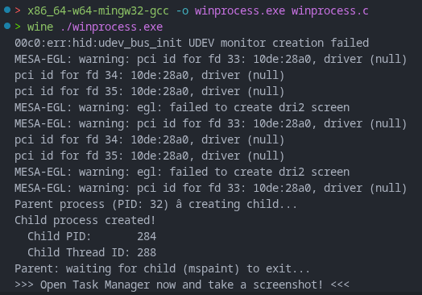
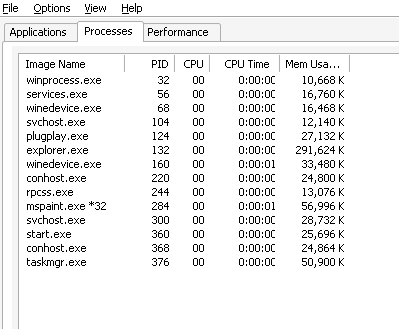
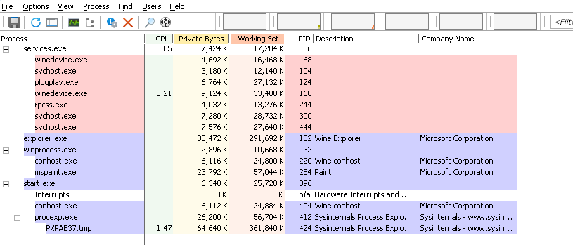
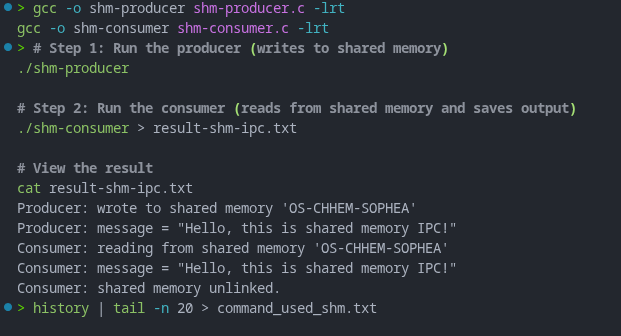
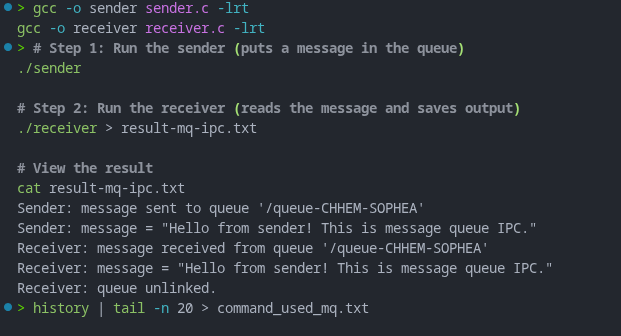

# Class Activity 2 — Processes & Inter-Process Communication

- **Student Name:** CHHEM SOPHEA
- **Student ID:** e20230596
- **Date:** 10.11.2026

---

## Task 1: Process Creation on Linux (fork + exec)

### Compilation & Execution

Screenshot of compiling and running `forkchild.c`:



### Process Tree

Screenshot of the parent-child process tree (using `ps --forest`, `pstree`, or `htop` tree view):



### Output

```
total 36
drwxr-xr-x 2 goodday goodday  4096 ១១  5 12:17 .
drwxr-xr-x 3 goodday goodday  4096 ១១  5 12:13 ..
-rw-r--r-- 1 goodday goodday   613 ១១  5 12:17 command_used_forkchild.txt
-rwxr-xr-x 1 goodday goodday 16488 ១១  5 12:07 forkchild
-rw-r--r-- 1 goodday goodday  1304 ១១  5 12:04 forkchild.c
-rw-r--r-- 1 goodday goodday     0 ១១  5 12:16 result_forkchild.txt
Parent process (PID: 25583) — creating child...
Parent: waiting for child (PID: 25584) to finish...
Parent: child exited with status 0
Parent: done.

```

### Questions

1. **What does `fork()` return to the parent? What does it return to the child?**

   > `fork()` returns 0 to the child and the child’s process ID (PID) to the parent. If  fork()  fails, it returns -1 to the parent and no child process create.

2. **What happens if you remove the `waitpid()` call? Why might the output look different?**

   > Without  `waitpid()`, the parent doesn’t wait for the child to be create, so their output may appear in a different order.

3. **What does `execlp()` do? Why don't we see "execlp failed" when it succeeds?**

   > `execlp()` makes the child run  ls -la  instead of its original program. If it works, the old program stops running, so it never reaches the “failed” message.

4. **Draw the process tree for your program (parent → child). Include PIDs from your output.**



5. **Which command did you use to view the process tree (`ps --forest`, `pstree`, or `htop`)? What information does each column show?**

   > I used `ps --forest`. The columns show:
   - **UID:** user running the process
   - **PID:** process ID
   - **PPID:** parent process ID
   - **C:** CPU usage estimate
   - **STIME:** start time
   - **TTY:** terminal, if any
   - **TIME:** CPU time used
   - **CMD:** command that started the process

---

## Task 2: Process Creation on Windows

### Compilation & Execution

Screenshot of compiling and running `winprocess.c`:



### Task Manager Screenshots

Screenshot showing process tree in the **Processes** tab (mspaint nested under your program):



Screenshot showing PID and Parent PID in the **Details** tab:



### Questions

1. **What is the key difference between how Linux creates a process (`fork` + `exec`) and how Windows does it (`CreateProcess`)?**

   > With Linux, the child starts as a copy of the parent, then  exec()  replaces that copy with a new program. With Windows,  CreateProcess()  starts the new program directly; it doesn’t first copy the parent.

2. **What does `WaitForSingleObject()` do? What is its Linux equivalent?**

   > `WaitForSingleObject()`  makes the parent wait until the child process finishes. The Linux equivalent is  `waitpid()` 

3. **Why do we need to call `CloseHandle()` at the end? What happens if we don't?**

   > `CloseHandle()` closes the handle to the child process. If we do not call it, the system keeps the handle open and may waste resources. It can also make the program look like it did not clean up properly.

4. **In Task Manager, what was the PID of your parent program and the PID of mspaint? Do they match your program's output?**

   > The parent PID was the one shown by the program, and the mspaint PID was the child process ID shown in Task Manager. They matched the values printed by the program, so the parent-child relationship was correct.

5. **Compare the Processes tab (tree view) and the Details tab (PID/PPID columns). Which view makes it easier to understand the parent-child relationship? Why?**

   > The Processes tab is easier because it shows the parent-child relationship visually as a tree. The Details tab is useful to see exact PIDs and PPIDs, but the tree view is easier to understand at a glance.

---

## Task 3: Shared Memory IPC

### Compilation & Execution

Screenshot of compiling and running `shm-producer` and `shm-consumer`:



### Output

```
[Paste the content of result-shm-ipc.txt here]
```

### Questions

1. **What does `shm_open()` do? How is it different from `open()`?**

   > `shm_open()` creates or opens a shared memory object for communication between processes. It is different from `open()` because `open()` works with files on disk, while `shm_open()` works with memory that is shared in RAM.

2. **What does `mmap()` do? Why is shared memory faster than other IPC methods?**

   > `mmap()` maps the shared memory into the process memory space, so both programs can read and write to the same area. It is faster because the data is shared directly in memory instead of being copied through the kernel many times.

3. **Why must the shared memory name match between producer and consumer?**

   > The name must match so both programs connect to the same shared memory object. If the names are different, they will access different memory regions and will not communicate.

4. **What does `shm_unlink()` do? What would happen if the consumer didn't call it?**

   > `shm_unlink()` removes the shared memory object name from the system. If the consumer did not call it, the shared memory may stay behind and could be reused or left as a wasted resource.

5. **If the consumer runs before the producer, what happens? Try it and describe the error.**

   > The consumer will fail because the shared memory object does not exist yet. The usual error is something like `shm_open failed` or `No such file or directory`.

---

## Task 4: Message Queue IPC

### Compilation & Execution

Screenshot of compiling and running `sender` and `receiver`:



### Output

```
[Paste the content of result-mq-ipc.txt here]
```

### Questions

1. **How is a message queue different from shared memory? When would you use one over the other?**

   > A message queue stores messages in a queue, while shared memory lets processes access the same memory directly. Use a message queue when you want simple message-based communication. Use shared memory when you need faster access to large data.

2. **Why does the queue name in `common.h` need to start with `/`?**

   > POSIX message queues use names that begin with `/` so the operating system can locate them correctly in the queue namespace. Without the `/`, the queue may not be created or opened properly.

3. **What does `mq_unlink()` do? What happens if neither the sender nor receiver calls it?**

   > `mq_unlink()` removes the queue name from the system. If neither side calls it, the queue may stay in the system and continue to use resources until it is cleaned up later.

4. **What happens if you run the receiver before the sender?**

   > The receiver waits for a message or may fail because the sender has not created and sent anything yet. In many programs, it just blocks until the sender sends a message.

5. **Can multiple senders send to the same queue? Can multiple receivers read from the same queue?**

   > Yes, more than one sender can send messages to the same queue, and more than one receiver can also read from the same queue. The messages are handled in order, and the processes compete for them as they are received.

---

## Reflection

What did you learn from this activity? What was the most interesting difference between Linux and Windows process creation? Which IPC method do you prefer and why?

> I learned that Linux creates a process by copying the parent and then replacing it with a new program, while Windows starts the new program directly with `CreateProcess()`. The most interesting difference is that Linux uses `fork()` and `exec()`, while Windows uses a single system call for the new process. I prefer message queues because they are simple and easy to understand for sending small messages. Shared memory is faster for large data, but it needs more care.
