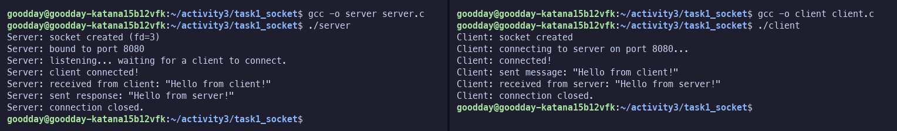
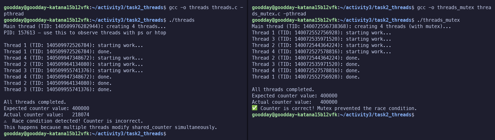
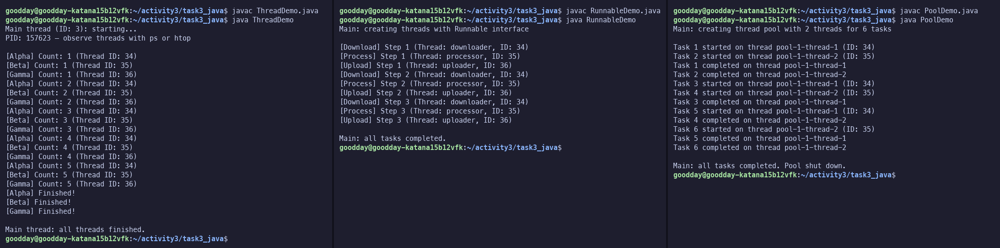
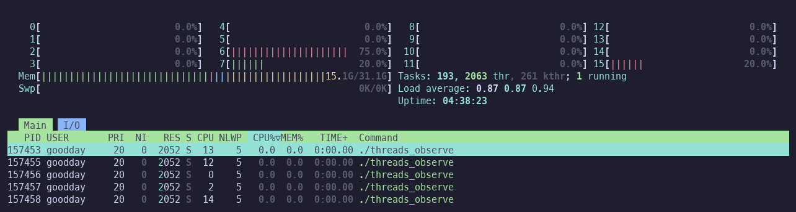
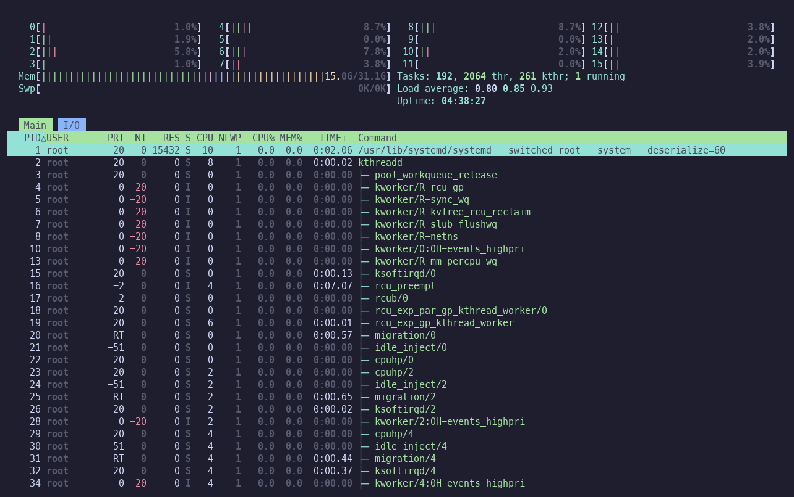
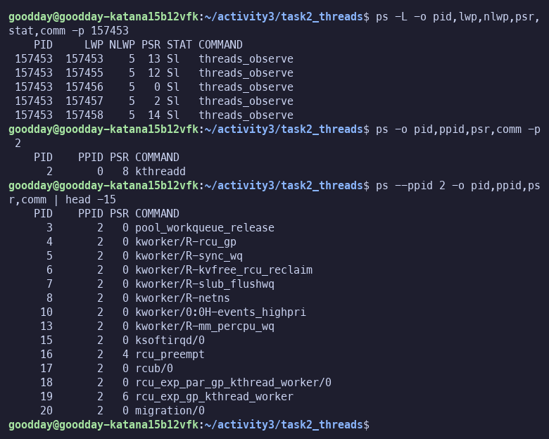
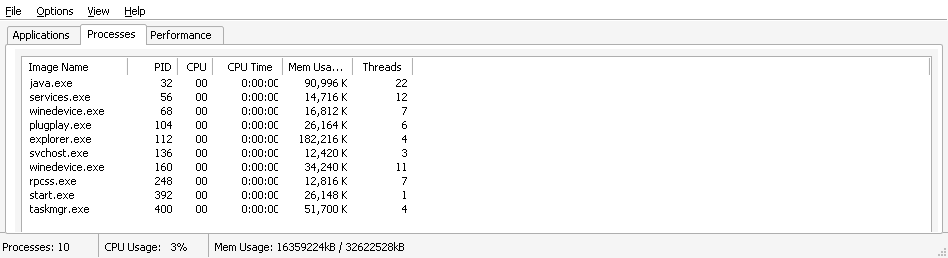

# Class Activity 3 — Socket Communication & Multithreading

- **Student Name:** CHHEM SOPHEA
- **Student ID:** e20230596
- **Date:** 16.11.2026

---

## Task 1: TCP Socket Communication (C)

### Compilation & Execution



### Answers

1. **Role of `bind()` / Why client doesn't call it:**
   > `bind()` puts the server socket on a fixed address and port (port 8080 here), so clients know where to find it. The client doesn't need a fixed port. When it calls `connect()`, the OS just gives it a random free port.

2. **What `accept()` return:**
   > It returns a new socket fd that is only for talking to that one client. The original `server_fd` stays as the listening socket and only waits for new connections. All the read/send happens on `client_fd`.

3. **Starting client before server:**
   > I ran `./client` with no server running and got `connect: Connection refused`. Nothing is listening on port 8080, so the OS rejects the connection right away and the client exits.

4. **What `htons()` does:**
   > It changes the port number from host byte order to network byte order (big-endian). My PC is little-endian, so without it, 8080 would be sent with its bytes swapped and the client would end up on the wrong port.

5. **Socket call sequence diagram:**
   ```
        SERVER                          CLIENT
        socket()                        socket()
          |                               |
        bind()  (port 8080)               |
          |                               |
        listen()                          |
          |                               |
        accept()  <---- connect ------  connect()
          |                               |
        read()    <---- "Hello from client!" ---- send()
          |                               |
        send()    ---- "Hello from server!" ----> read()
          |                               |
        close()                         close()
   ```

---

## Task 2: POSIX Threads (C)

### Output — Without Mutex (Race Condition)



### Output — With Mutex (Correct)

Same screenshot, right side. Without the mutex the counter came out different every run (I got 336302, 170017, 170568, 145080, 255634), but it should be 400000. With the mutex it's 400000 every time.

### Answers

1. **What is a race condition?**
   > It's when two or more threads use the same data at the same time and the result depends on who runs first. `shared_counter++` is really 3 steps: read, add 1, write back. Two threads can read the same value, both add 1, and both write it back, so one of the increments is lost. That's why the number comes out too low.

2. **What does `pthread_mutex_lock()` do?**
   > It locks the mutex so only one thread at a time can go into that part of the code. Other threads have to wait until it calls `unlock`. That way the read, add, write steps of `counter++` can't get mixed up between threads, so no increment is lost.

3. **Removing `pthread_join()`:**
   > I tried it. `main` doesn't wait, so it prints the result right away (I got `Actual counter value: 20474`) and then returns. When `main` returns, the whole process exits and the other threads get killed in the middle of their work. Most of them didn't even print "done".

4. **Thread vs Process:**
   > A process has its own memory space. A thread is a path of execution inside a process. Threads in the same process share the code, global variables, heap and open files. Each thread has its own stack, registers, program counter and thread ID. Making a thread is cheaper than `fork()`, but because memory is shared you get problems like the race condition above.

---

## Task 3: Java Multithreading

### ThreadDemo Output



### RunnableDemo Output

Middle panel of the screenshot above. Also in `task3_java/result_runnable_demo.txt`.

### PoolDemo Output

Right panel of the screenshot above. Also in `task3_java/result_pool_demo.txt`.

### Answers

1. **Thread vs Runnable:**
   > Extending `Thread` means your class *is* a thread, and Java only lets you extend one class. With `Runnable` you only write the task, then hand it to a `Thread` (or a thread pool). Your class can still extend something else, and the task is kept separate from how it runs. I'd mostly use `Runnable`. Extending `Thread` is fine for small quick demos.

2. **Pool size limiting concurrency:**
   > `newFixedThreadPool(2)` only makes 2 worker threads (`pool-1-thread-1` and `-2`). The 6 tasks go into a queue, and each worker takes the next task when it finishes one. So only 2 run at a time, and you can see tasks 3/4 start only after 1/2 complete.

3. **thread.join() in Java:**
   > `join()` makes the main thread wait until that thread is done. I removed the joins and ran it. Main printed "Main thread: all threads finished." straight away, before Alpha/Beta/Gamma even printed Count 1, and the threads kept running after that. The JVM doesn't exit until normal (non-daemon) threads finish, so they still complete, but main's message is wrong.

4. **ExecutorService advantages:**
   > It reuses a few threads instead of making a new one for every task, which saves time and memory. You can limit how many threads run, so 1000 tasks don't turn into 1000 threads. It also handles the task queue and shutdown, and lets you get results back with `Future`. That means less thread code to manage yourself.

---

## Task 4: Observing Threads

### Linux — `ps -eLf` Output

```
$ ps -eLf | grep threads_observe
goodday   157453  157452  157453  0    5 20:04 ?        00:00:00 ./threads_observe
goodday   157453  157452  157455  0    5 20:04 ?        00:00:00 ./threads_observe
goodday   157453  157452  157456  0    5 20:04 ?        00:00:00 ./threads_observe
goodday   157453  157452  157457  0    5 20:04 ?        00:00:00 ./threads_observe
goodday   157453  157452  157458  0    5 20:04 ?        00:00:00 ./threads_observe

$ ls /proc/157453/task/
157453  157455  157456  157457  157458
```

Full output is in `task2_threads/result_observe_linux.txt`.

### Linux — htop Thread View



### Linux — htop Kernel Threads (tree view, `kthreadd`)



### Linux — Kernel Threads (commands)



```
$ ps -L -o pid,lwp,nlwp,psr,stat,comm -p 157453
    PID     LWP NLWP PSR STAT COMMAND
 157453  157453    5  13 Sl   threads_observe
 157453  157455    5  12 Sl   threads_observe
 157453  157456    5   0 Sl   threads_observe
 157453  157457    5   2 Sl   threads_observe
 157453  157458    5  14 Sl   threads_observe

$ ps -o pid,ppid,psr,comm -p 2
    PID    PPID PSR COMMAND
      2       0   8 kthreadd

$ ps --ppid 2 -o pid,ppid,psr,comm | head -15
    PID    PPID PSR COMMAND
      3       2   0 pool_workqueue_release
      4       2   0 kworker/R-rcu_gp
      5       2   0 kworker/R-sync_wq
      6       2   0 kworker/R-kvfree_rcu_reclaim
      7       2   0 kworker/R-slub_flushwq
      8       2   0 kworker/R-netns
     10       2   0 kworker/0:0H-events_highpri
     13       2   0 kworker/R-mm_percpu_wq
     15       2   0 ksoftirqd/0
     16       2   4 rcu_preempt
     17       2   0 rcub/0
     18       2   0 rcu_exp_par_gp_kthread_worker/0
     19       2   6 rcu_exp_gp_kthread_worker
     20       2   0 migration/0
```

### Windows — Task Manager



I don't have Windows installed, so I did this part with Wine on Linux: Windows Java (Temurin JRE 25 `java.exe`) running `ThreadDemo` (sleep changed to 5000 ms), and Wine's Task Manager on the Processes tab with the Threads column turned on. `java.exe` shows 22 threads.

### Answers

1. **LWP column meaning:**
   > LWP means Light Weight Process. It's the thread ID the kernel uses. Every row with the same PID is one process, and each LWP is one thread in it. On Linux a thread is basically a task that shares memory with the others, so it gets its own ID like a process does.

2. **/proc/PID/task/ count:**
   > 5 entries (157453, 157455, 157456, 157457, 157458). That matches: 4 worker threads + 1 main thread. `/proc/157453/status` also shows `Threads: 5`.

3. **Extra Java threads:**
   > The JVM runs its own threads besides the ones I created. These include the garbage collector threads, JIT compiler threads, Finalizer, Reference Handler, Signal Dispatcher, and some others. In my screenshot `java.exe` had 22 threads, even though I only made 3 (plus main).

4. **Linux vs Windows thread viewing:**
   > Task Manager only shows the thread count of each process. On Linux, `ps -L` and `/proc` show every thread separately with its own ID, state and which CPU it's on, and you can save it as text. htop shows them live too. Linux gives a lot more detail (on Windows you'd need something like Process Explorer to see that much).

5. **kthreadd and three kernel threads:**
   > `kthreadd` is the kernel thread that creates all the other kernel threads. Its PID is 2 and its parent is 0. Three I found: `ksoftirqd/0`, `rcu_preempt` and `migration/0` (also lots of `kworker/...`). You can tell they're kernel threads because their parent (PPID) is 2, they belong to root, and they use 0 memory (RES = 0) because they have no user memory space. `ps -ef` also shows their names in `[brackets]`.

6. **TID equal to PID, NLWP and cores:**
   > The main thread has the same ID as the PID (157453). The other 4 have their own IDs. NLWP is the number of threads in the process, which is 5. In `ps -L` they were on cores 13, 12, 0, 2 and 14. So they got spread across different CPUs, and the cores change between runs.

7. **`H` and `K` in htop:**
   > `H` shows/hides the user threads of each process. Without it you only see one row for `threads_observe` and not the 4 workers. `K` shows/hides kernel threads. Without it, `kthreadd` and its children (kworker, ksoftirqd, ...) are hidden, so it looks like only normal programs are running.

---

## Reflection

> The part I liked most was seeing the threads show up in `ps` and htop with their own IDs while sharing one PID. It made it clear that, for Linux, a thread is just another task that shares memory. The race condition was also interesting because the code looks totally fine, yet the number is wrong every time. Knowing how the OS sees threads helps me understand why shared data needs a lock and why join matters.
