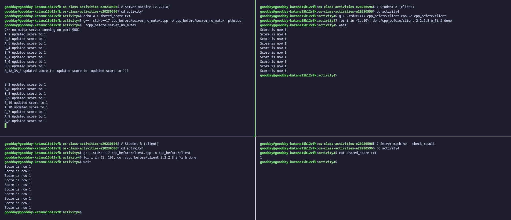
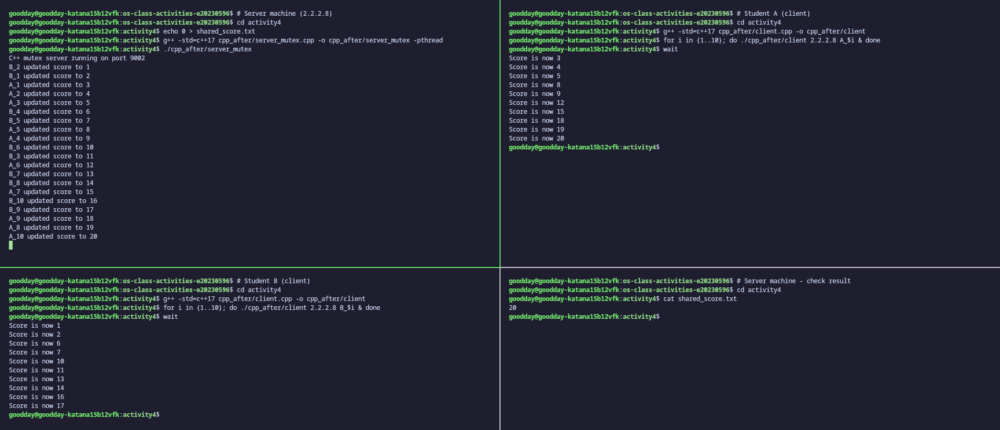
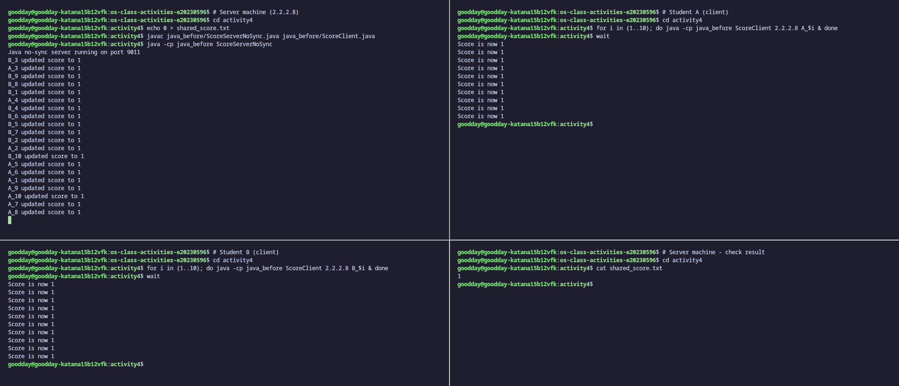
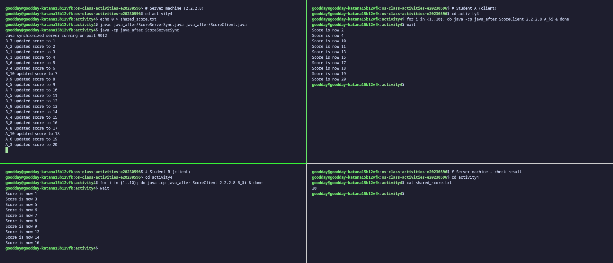

# Class Activity 4 — Shared File API

- **Student Name:** CHHEM SOPHEA
- **Student ID:** e20230596
- **Partner Name:** [Partner Name]
- **Partner Student ID:** [Partner ID]
- **Server Machine Owner:** CHHEM SOPHEA
- **Server IP Address:** 2.2.2.8

---

## Task 1: C++ Before Mutex

- Expected score after 20 total client requests: 20
- Actual score: 1
- What happened: All 20 server threads read the file at almost the same time, so they all saw `0`. Then each one waited 200 ms, added 1 and wrote `1` back. Every client got "Score is now 1" and 19 updates were lost. The server log is even mixed up on one line (`B_1A_3A_4 updated score to ...`) because the threads print at the same time too.

---

## Task 2: C++ After Mutex

- Expected score after 20 total client requests: 20
- Actual score: 20
- What changed after adding mutex: Only one thread can be inside `update_score()` at a time now. The score goes up 1, 2, 3 ... 20 in order and every client gets a different number. It is slower (about 20 × 200 ms = 4 s) because the requests wait in line, but the result is correct every time.

---

## Task 3: Java Before Synchronized

- Expected score after 20 total client requests: 20
- Actual score: 1
- What happened: Same problem as the C++ version. Each client gets its own `Thread`, and all of them read `0` from the file before anyone wrote. They all wrote `1`, so the final file is `1`.

---

## Task 4: Java After Synchronized

- Expected score after 20 total client requests: 20
- Actual score: 20
- What changed after adding synchronized: `updateScore()` is now `static synchronized`, so the threads take turns. Each update reads the value the last thread wrote, and the score counts up to 20 with no lost updates.

---

## Questions

1. **Why should clients send requests to the server instead of writing the file directly?**
   > If every client writes the file itself, there is no single place to control who goes first, and the clients on other machines can't even see each other's locks. With a server, only one program touches the file, so we can put the protection in one place.

2. **Why does the server still have a race condition before mutex or synchronized?**
   > The server makes one thread per client, and the threads run at the same time. Read → +1 → write is not one step, and there is a 200 ms sleep in the middle. So many threads read the same old value and then overwrite each other.

3. **In the C++ fixed version, what does `std::lock_guard<std::mutex>` protect?**
   > It locks `file_mutex` for the whole `update_score()` function: reading the file, the sleep, adding 1, writing the file and printing. The lock is released automatically when the function returns.

4. **In the Java fixed version, what does `synchronized` protect?**
   > The whole `updateScore()` method. Since it is `static synchronized`, all threads use the same lock (the `ScoreServerSync` class), so only one thread can read and write the file at a time.

5. **Why is the final score expected to be 20 when Student A sends 10 requests and Student B sends 10 requests?**
   > The file starts at 0 and each request should add exactly 1. 10 + 10 = 20 requests, so the score should be 20 if no update is lost.

6. **What could happen if two separate servers update the same file at the same time?**
   > We get the race condition again. A mutex or `synchronized` only works inside one process, so server 1 doesn't know server 2 is holding a lock. Both can read the same value and overwrite each other. To fix it you need one server only, or a lock that works between processes (like a file lock with `flock`).

---

## Reflection

Both versions had the exact same bug and the fix was just a few words. In C++ I had to create a `std::mutex` myself and lock it with `std::lock_guard`, which unlocks by itself when the function ends. In Java I only added `synchronized` to the method and Java handled the lock for me. Java is shorter, but C++ shows more clearly what is being locked.

What surprised me was how bad the result was without a lock: not 18 or 19, but 1. The 200 ms sleep makes the gap between read and write big, so almost every thread overlaps. The lesson for me is that putting everything behind one server is not enough by itself. If the server is multithreaded, the part that reads and writes the shared file still has to be protected.
